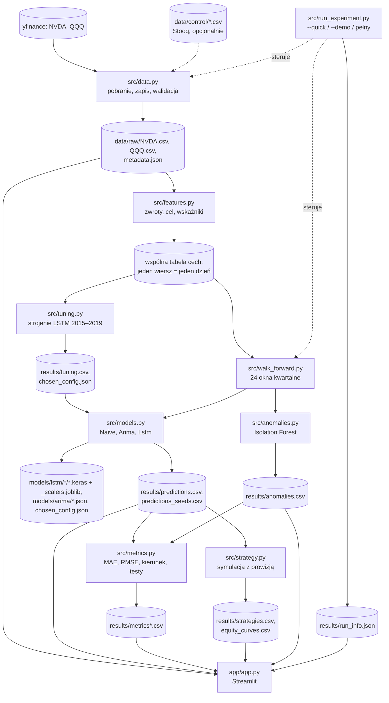

# Architektura systemu

Opis modułów i przepływu danych. Kod jest podzielony na małe moduły o jednej odpowiedzialności;
wszystkie parametry są w `src/config.py`. Nazwy w kodzie po angielsku, komentarze po polsku.

## Diagram przepływu danych



## Moduły

| Moduł | Odpowiedzialność | Najważniejsze funkcje / klasy |
|---|---|---|
| `src/config.py` | wszystkie parametry (daty, cechy, siatka strojenia, prowizja, tryby) | stałe |
| `src/data.py` | pobranie z yfinance, zapis CSV i `metadata.json`, walidacja, porównanie ze Stooq | `ensure_data`, `validate_prices`, `compare_with_control` |
| `src/features.py` | zwroty logarytmiczne, zmiana logarytmu wolumenu, Close/SMA, RSI Wildera, zmienność, zwrot QQQ, cel | `build_feature_table` |
| `src/models.py` | wspólny interfejs `fit`/`predict`; model naiwny, ARIMA, LSTM; wybór rzędu ARIMA po AIC; zapis i wczytanie modeli (`save`/`load`) | `BaseModel`, `NaiveModel`, `ArimaModel`, `LstmModel`, `select_arima_order` |
| `src/walk_forward.py` | podział na okna kwartalne z oknem rozszerzającym, pętla ucz–prognozuj, pomiar czasu, hak `on_fitted` do zapisu modeli | `make_windows`, `run_model_on_windows` |
| `src/tuning.py` | siatka 8 kombinacji × 2 warianty, kryterium MAE z regułą odrzucenia modeli zapadniętych | `run_tuning`, `summarize_tuning`, `load_or_run_tuning` |
| `src/anomalies.py` | Isolation Forest dopasowany na danych uczących okna, oznaczanie dni testowych | `fit_and_flag`, `flag_windows` |
| `src/metrics.py` | MAE, RMSE, trafność kierunku, odsetek prognoz wzrostu, std prognoz, test McNemara, test dwumianowy | `compute_metrics`, `mcnemar_exact`, `binomial_test_accuracy` |
| `src/strategy.py` | kup i trzymaj, podstawowa, z progiem; prowizje; CAGR, obsunięcie, Sharpe | `simulate`, `evaluate_strategies` |
| `src/run_experiment.py` | spina wszystko, zapisuje `results/` i `run_info.json` | `main` |
| `app/app.py` | aplikacja Streamlit, tylko czyta `data/` i `results/` | zakładki |
| `tests/` | pytest: wyciek, wyrównanie celu, okna, te same daty, skaler, miary, prowizje, aplikacja | |

## Wspólny interfejs modeli

```
BaseModel
 ├── fit(train_data)      uczy model na tabeli cech z dni uczących
 ├── predict(test_data)   zwraca prognozowany zwrot dla każdego dnia testowego
 └── n_parameters()       liczba parametrów (koszt modelu)
   NaiveModel   zawsze 0
   ArimaModel   ARIMA(p,0,q) na zwrotach; w kwartale append(refit=False) + forecast(1)
   LstmModel    skalery na 80% dni uczących, sekwencje z okna, EarlyStopping na ostatnich 20%
```

To wzorzec znany z C#: klasa bazowa i dziedziczenie; silnik walk-forward nie wie, z jakim modelem pracuje.

## Schemat walk-forward

```
dni:   2015 ........................ 2019 | 2020Q1 | 2020Q2 | 2020Q3 | ... | 2025Q4
okno 1 [ uczenie (+ strojenie zamrożone)  ] [ test ]
okno 2 [ uczenie                                   ] [ test ]
okno 3 [ uczenie                                            ] [ test ]
...                                                                        ... okno 24
```

W każdym oknie: skaler, Isolation Forest i parametry modelu dopasowane tylko na dniach uczących.
Okno LSTM dla pierwszych dni kwartału sięga wstecz do ostatnich dni uczących (dane z przeszłości).

## Pliki wyników

| Plik | Zawartość |
|---|---|
| `predictions.csv` | date, model, y_true, y_pred, window (LSTM uśredniony po ziarnach) |
| `predictions_seeds.csv` | to samo dla każdego ziarna LSTM osobno |
| `metrics.csv` | miary, testy statystyczne, liczba parametrów, czas uczenia, rozrzut ziaren |
| `metrics_by_year.csv`, `metrics_anomalies.csv`, `metrics_seeds.csv` | rozbicia opisowe |
| `anomalies.csv` | date, is_anomaly, anomaly_score, window |
| `anomalies_descriptive_2015_2019.csv` | analiza opisowa, nieużywana w ocenie |
| `tuning.csv`, `tuning_seeds.csv`, `chosen_config.json` | strojenie LSTM |
| `arima_order.json`, `arima_order_search.csv` | wybór rzędu ARIMA |
| `strategies.csv`, `equity_curves.csv` | strategie i wartość portfela |
| `costs_by_window.csv` | czas uczenia i parametry w każdym oknie |
| `run_info.json` | tryb, czas, wersje bibliotek, parametry |

## Zapisane modele (`models/`)

| Ścieżka | Zawartość |
|---|---|
| `models/lstm/<A lub B>/<kwartał>_seed<n>.keras` | sieć Keras (architektura i wagi) z danego okna i ziarna |
| `models/lstm/<A lub B>/<kwartał>_seed<n>_scalers.joblib` | skalery cech i celu, lista cech, ustawienia, ostatnie dni uczące potrzebne do pierwszych okien kwartału |
| `models/arima/<kwartał>.json` | rząd i parametry ARIMA okna (do odtworzenia potrzebne są też dane uczące okna) |
| `models/chosen_config.json` | kopia wybranych ustawień LSTM ze strojenia |

W repozytorium git są modele ostatniego okna (2025Q4), parametry ARIMA i wybrana konfiguracja; pozostałe modele LSTM
powstają lokalnie przy każdym przebiegu i są ignorowane przez git (patrz README).
